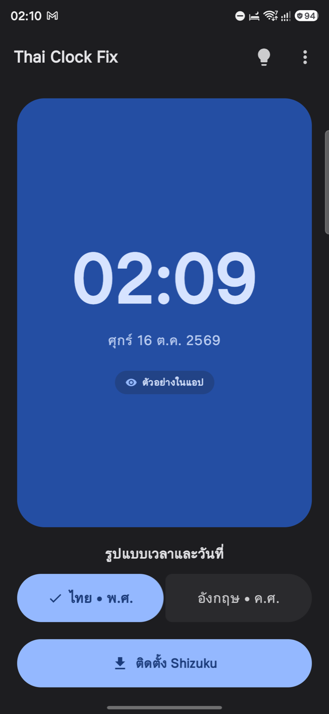
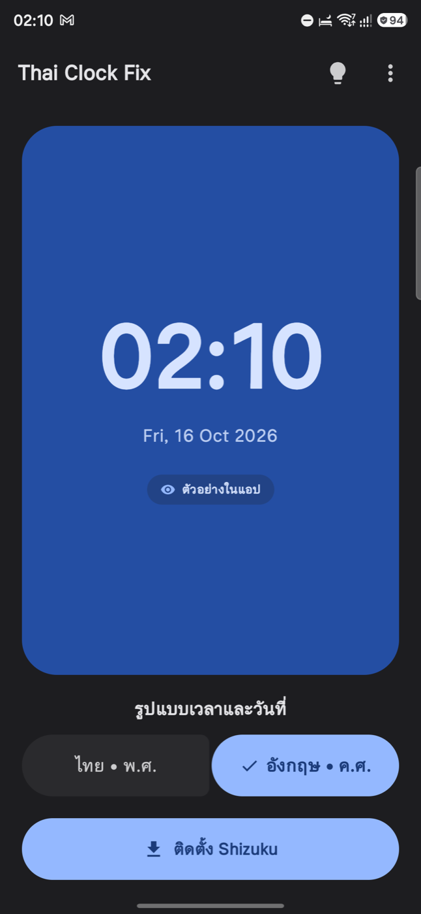
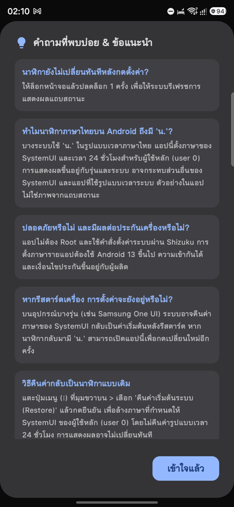
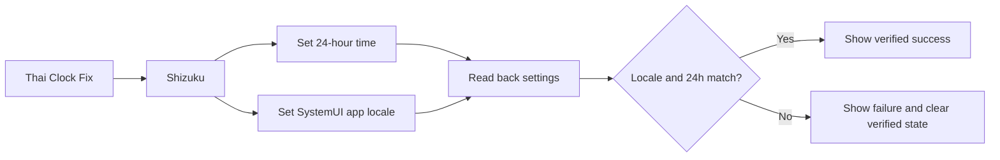

<h1 align="center">Thai Clock Fix</h1>

<p align="center">
  ตั้งค่า locale ของ Android SystemUI และเวลา 24 ชั่วโมงผ่าน Shizuku โดยไม่ต้อง Root
</p>

<p align="center">
  <a href="https://github.com/justl3as/thai-clock-fix/actions/workflows/ci.yml"></a>
  <a href="https://github.com/justl3as/thai-clock-fix/actions/workflows/codeql.yml"></a>
  <a href="https://github.com/justl3as/thai-clock-fix/releases/latest"></a>
</p>

<p align="center">
  <a href="https://github.com/justl3as/thai-clock-fix/releases/latest"><strong>ดาวน์โหลดรุ่นล่าสุด</strong></a>
  ·
  <a href="PRODUCT.md">Product spec</a>
  ·
  <a href="SECURITY.md">Security policy</a>
</p>

Thai Clock Fix เป็นแอป Android สำหรับผู้ใช้ที่ต้องการควบคุมรูปแบบเวลาและวันที่ของ SystemUI โดยเฉพาะกรณีที่รูปแบบภาษาไทยบน status bar แสดง `น.` ต่อท้ายเวลา แอปใช้ Shizuku เพื่อเรียกคำสั่งระบบสำหรับผู้ใช้หลักของเครื่อง (`user 0`) และอ่านค่ากลับก่อนแจ้งว่าสำเร็จ

> [!NOTE]
> แอปไม่ได้แก้ข้อความ ฟอนต์ หรือ resource ภายใน SystemUI โดยตรง การแสดงผลสุดท้ายยังขึ้นอยู่กับ Android และ OEM ของอุปกรณ์

## App preview

<p align="center">
  <a href="docs/images/app-preview-home.png"></a>
  &nbsp;
  <a href="docs/images/app-preview-english.png"></a>
  &nbsp;
  <a href="docs/images/app-preview-faq.png"></a>
</p>

<p align="center">
  <sub>ไทย • พ.ศ. &nbsp;·&nbsp; อังกฤษ • ค.ศ. &nbsp;·&nbsp; คำถามที่พบบ่อยและคำแนะนำ</sub>
</p>

ภาพตัวอย่างมาจากแอปจริงบน Android โดยโหมดเวลาและวันที่ในหน้าหลักเป็น preview สำหรับเปรียบเทียบรูปแบบก่อนนำไปใช้กับ SystemUI

## ทำอะไรได้บ้าง

- ตั้งเวลา Android เป็นรูปแบบ 24 ชั่วโมง
- ตั้ง locale ของ `com.android.systemui` เป็นไทย พ.ศ. หรืออังกฤษสหรัฐฯ
- อ่าน locale และค่า 12/24 ชั่วโมงกลับจากระบบก่อนยืนยันผล
- คืนค่า locale override ของ SystemUI กลับไปใช้ภาษาระบบ
- แสดงคำสั่ง ADB สำหรับผู้ใช้ที่ต้องการทำงานแบบ manual
- แนะนำขั้นตอนติดตั้ง เริ่ม และอนุญาต Shizuku จากในแอป

## เริ่มใช้งาน

> [!IMPORTANT]
> การใช้งานจริงต้องใช้ Android 13 ขึ้นไป เนื่องจากแอปอาศัยคำสั่ง per-app locale ของ Android แม้ package จะกำหนด `minSdk = 26` ก็ตาม

1. ติดตั้งและเริ่ม [Shizuku](https://shizuku.rikka.app/)
2. ดาวน์โหลด APK จาก [Latest Release](https://github.com/justl3as/thai-clock-fix/releases/latest)
3. เปิด Thai Clock Fix แล้วอนุญาตสิทธิ์ Shizuku
4. เลือกรูปแบบที่ต้องการ
5. แตะ **ใช้รูปแบบนี้**
6. ตรวจนาฬิกาบนเครื่อง หาก status bar ยังไม่รีเฟรช ให้ล็อกและปลดล็อกหน้าจอหนึ่งครั้ง

แอปทำงานกับ Android owner user (`user 0`) เท่านั้น อุปกรณ์บางรุ่นอาจคืนค่า SystemUI locale หลัง reboot หรือ system update

## รูปแบบที่รองรับ

| โหมด | Locale | ผลที่ตั้ง |
| --- | --- | --- |
| ไทย • พ.ศ. | `th-TH-u-ca-buddhist` | SystemUI ใช้ locale ไทยพร้อม Buddhist calendar และเวลา 24 ชั่วโมง |
| อังกฤษ • ค.ศ. | `en-US` | SystemUI ใช้ locale อังกฤษสหรัฐฯ และเวลา 24 ชั่วโมง |
| Restore | system default | ล้าง locale override ของ SystemUI โดยไม่เปลี่ยนค่า 12/24 ชั่วโมง |

## วิธีทำงาน



การเปลี่ยนค่าและการ readback ใช้คิวเดียวกัน เพื่อไม่ให้ผลอ่านเก่ามาทับผลจากคำสั่งที่เพิ่งทำเสร็จ

<details>
<summary>คำสั่งระบบหลักที่แอปใช้</summary>

```sh
LOCALE_TAG="en-US" # หรือ th-TH-u-ca-buddhist
settings --user 0 put system time_12_24 24
cmd locale set-app-locales com.android.systemui --user 0 --locales "$LOCALE_TAG"
cmd locale get-app-locales com.android.systemui --user 0
settings --user 0 get system time_12_24
```

Restore ใช้ locale ว่างเพื่อล้าง per-app override ของ SystemUI

```sh
cmd locale set-app-locales com.android.systemui --user 0 --locales ""
```

</details>

## ข้อจำกัดที่ควรรู้

> [!WARNING]
> การเปลี่ยน locale ของ SystemUI อาจกระทบข้อความหรือรูปแบบวันที่ส่วนอื่นของ SystemUI ไม่ใช่เฉพาะนาฬิกาบน status bar

- Restore คืนเฉพาะ SystemUI locale override และไม่คืนค่ารูปแบบ 12/24 ชั่วโมงเดิม
- แอปไม่ restart SystemUI และไม่ reboot เครื่องให้อัตโนมัติ
- ตัวอย่างเวลาในแอปเป็น preview ไม่ใช่ภาพหรือการตรวจจับ status bar จริง
- OEM บางรายอาจไม่ยอมรับคำสั่งเดียวกัน หรืออาจคืนค่าหลัง reboot/update
- Shizuku ต้องพร้อมและได้รับ permission ก่อนใช้คำสั่งระบบ

รายละเอียดขอบเขตและพฤติกรรมที่ถือว่าเป็น product contract อยู่ใน [PRODUCT.md](PRODUCT.md)

## ดาวน์โหลดและตรวจสอบ APK

ทุก GitHub Release มี APK และไฟล์ `.sha256` คู่กัน

```sh
# Linux
sha256sum -c *.apk.sha256

# macOS
shasum -a 256 -c *.apk.sha256
```

Release APK ต้องใช้ production signing identity เดิมทุกเวอร์ชัน ดู certificate fingerprint, threat model และ release integrity policy ได้ใน [SECURITY.md](SECURITY.md)

## Build from source

ต้องมี:

- JDK 17
- Android SDK 37
- Android platform package `platforms;android-37.0`

ชุดตรวจเดียวกับ CI:

```sh
./gradlew --no-daemon \
  :app:spotlessCheck \
  :app:testDebugUnitTest \
  :app:lintRelease \
  :app:assembleRelease
```

สร้าง debug APK:

```sh
./gradlew :app:assembleDebug
```

JaCoCo coverage เป็น opt-in เพื่อไม่เพิ่ม overhead ให้ build ปกติ:

```sh
./gradlew -Pcoverage=true :app:createDebugUnitTestCoverageReport
```

Application ID และ namespace ของ production build คือ `com.thaiclockfix`

## Quality and release pipeline

Pull request และ push เข้า `main` ต้องผ่าน `verify` ซึ่งตรวจ formatting, unit tests, Android release lint และ R8/resource-shrunk release build

CodeQL ตรวจ GitHub Actions และ Java/Kotlin แยกจาก CI ปกติ โดย Java/Kotlin ใช้ manual compile ที่ปิด Gradle build cache สำหรับงานวิเคราะห์ เพื่อให้ CodeQL เห็น source compilation ทุกครั้ง

Tag รูปแบบ `vMAJOR.MINOR.PATCH` จะเรียก release workflow เพื่อ:

1. แปลง semantic version เป็น Android `versionCode`
2. build และ sign release APK ด้วย production key จาก GitHub Actions Secrets
3. ตรวจลายเซ็นด้วย `apksigner` และบังคับให้ signing certificate SHA-256 ตรงกับ production fingerprint ที่ประกาศไว้
4. สร้าง SHA-256 checksum
5. แนบ APK และ checksum เข้า GitHub Release

## Project docs

- [PRODUCT.md](PRODUCT.md) กำหนด product scope, user journey, success criteria, non-goals และข้อจำกัดทางเทคนิค
- [SECURITY.md](SECURITY.md) อธิบาย security model, vulnerability reporting, APK signing และ supply-chain controls
